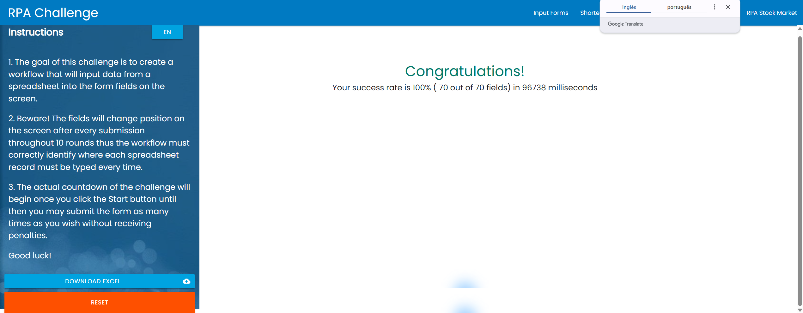
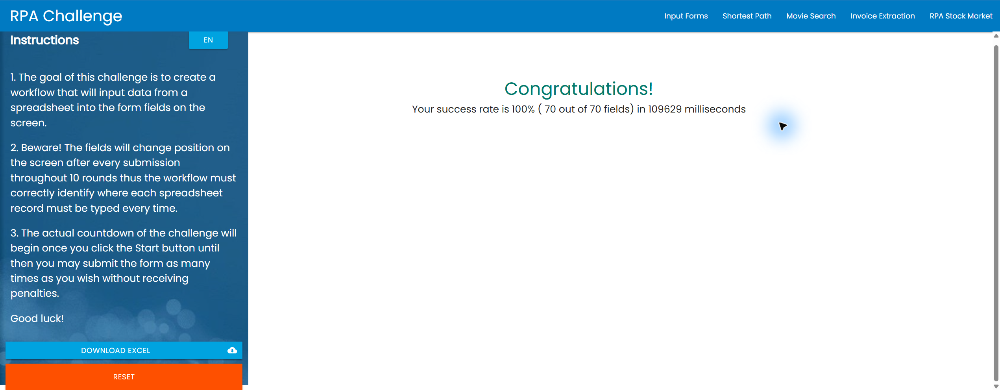
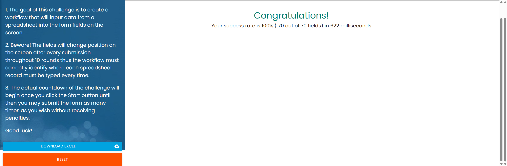

# Evidências das execuções reais

Execuções em 06/11/2026, horário de Brasília (UTC−03:00), no site https://rpachallenge.com/, com os dez registros da mesma planilha `challenge.xlsx`.

| Implementação | Início do log | Resultado exibido pelo site | Tempo do site |
| --- | --- | --- | --- |
| Power Automate Desktop — atraso 40 ms | 20:42:08 | 100% — 70 de 70 campos | 109629 ms |
| Power Automate Desktop — atraso 1 ms | 20:53:39 | 100% — 70 de 70 campos | 96738 ms |
| Python + Selenium + Pandas | 20:40:21 | 100% — 70 de 70 campos | 622 ms |

## Power Automate Desktop — atraso reduzido para 1 ms

Alteração isolada de **Atraso na execução**, na barra inferior do editor, de 40 para 1 ms. O mínimo aceito pelo editor é 1 ms. O texto de ações não mudou. A configuração é do editor e deve ser aplicada ao reproduzir a execução; ela não é exportada em `fluxo.txt`.

O tempo exibido pelo site caiu de 109629 para 96738 ms, mantendo 70/70 campos corretos. Diferença observada: 12891 ms (11,76%). Cada medição corresponde a uma execução, sem garantir o mesmo ganho em outras máquinas ou repetições.

- [Print original com atraso de 1 ms](power-automate/resultado_final_20261106_205339.png)
- [Log de etapas com atraso de 1 ms](power-automate/etapas_20261106_205339.log)
- [Resultado das dez linhas com atraso de 1 ms](power-automate/resultados_20261106_205339.txt)

Referência: [depuração de fluxos — campo Run delay](https://learn.microsoft.com/en-us/power-automate/desktop-flows/debugging-flow).

## Power Automate Desktop — execução anterior (40 ms)

- [Print original da pontuação](power-automate/resultado_final_20261106_204208.png)
- [Log de etapas](power-automate/etapas_20261106_204208.log)
- [Resultado das dez linhas](power-automate/resultados_20261106_204208.txt)

## Python

- [Print original da pontuação](python/resultado_final_20261106_204021_108904.png)
- [Log de etapas e pontuação](python/etapas_20261106_204021_108904.log)
- [Resultado das dez linhas](python/resultados_20261106_204021_108904.csv)

## Validação e ambiente

Ambos os resultados foram conferidos nas capturas originais geradas pelas automações. Os registros das linhas 2 a 11 apresentam dez envios OK em cada implementação. OK indica o envio; a confirmação de acerto é a avaliação global do site nas capturas.

O tempo informado pelo site cobre as dez rodadas, sem leitura do Excel ou inicialização do Chrome. Os valores representam execuções individuais, não uma média de desempenho.

- Windows; Google Chrome 156.0.8078.80.
- Python 3.14.3; Pandas 3.0.3; Selenium 4.42.0; openpyxl 3.1.5.
- SHA-256 da planilha utilizada: `cf1a8c04a298cc12cb481a0a6c88b078b209dc59c4983f6ca78714d611c04d37`.
- Os três testes locais do Python também passaram. São testes com navegador simulado e não foram usados como evidência da pontuação real.
- Os arquivos de execução foram preservados sem edição. A planilha não foi publicada.
